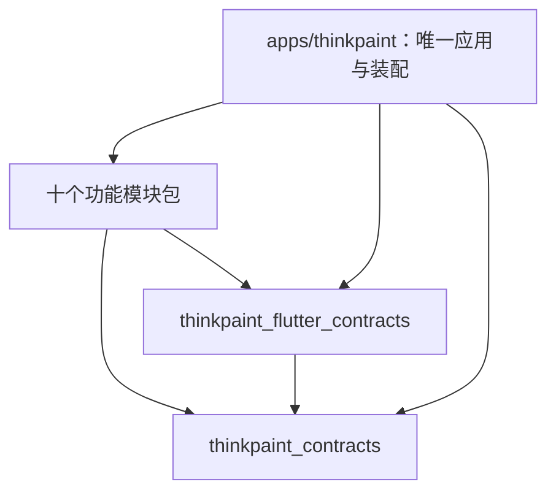

# ThinkPaint 工程结构与模块代码归属

更新日期：2026-10-19。架构版本：0.1。

ThinkPaint 使用 Flutter、Dart 和自定义绘制画布，在同一仓库内组织一个应用、两个共享契约包和十个功能模块包。package 是 Dart 的代码与依赖管理单位；共享契约包只规定模块交换的数据和调用方式，具体行为由模块实现。

以下均为工程建立时的目标目录。目录规划不代表工程已经创建、依赖已经安装或双端已经构建通过。接口语义见 [共享接口](SHARED_CONTRACTS.md)，技术决定见 [统一技术路线](PLATFORM_DECISION.md)，分支与工作目录规则见 [开发计划](../DEVELOPMENT_PLAN.md)。

## 整体目录

```text
ThinkPaint/
├─ apps/
│  └─ thinkpaint/
│     ├─ lib/
│     │  ├─ main.dart
│     │  └─ bootstrap/
│     ├─ android/
│     ├─ windows/
│     └─ integration_test/
├─ packages/
│  ├─ thinkpaint_contracts/
│  │  └─ lib/
│  │     ├─ thinkpaint_contracts.dart
│  │     └─ src/
│  │        ├─ models/
│  │        ├─ ports/
│  │        └─ extensions/
│  ├─ thinkpaint_flutter_contracts/
│  │  └─ lib/
│  │     ├─ thinkpaint_flutter_contracts.dart
│  │     └─ src/
│  │        ├─ rendering/
│  │        ├─ tools/
│  │        └─ widgets/
│  ├─ thinkpaint_management/
│  ├─ thinkpaint_drawing/
│  ├─ thinkpaint_images/
│  ├─ thinkpaint_canvas/
│  ├─ thinkpaint_search/
│  ├─ thinkpaint_text/
│  ├─ thinkpaint_editing/
│  ├─ thinkpaint_relations/
│  ├─ thinkpaint_storage/
│  └─ thinkpaint_platform/
├─ docs/
│  ├─ architecture/
│  ├─ design/
│  ├─ modules/
│  ├─ tasks/
│  └─ validation/
├─ AGENTS.md
└─ PROGRESS.md
```

工程建立时在仓库根部配置 Dart pub workspace，统一解析应用与十二个包的依赖，维护一个根目录依赖锁文件。Dart 官方 workspace 支持共同的依赖解析和锁文件；具体 SDK、依赖版本及 manifest 由后续工程装配统一建立。[Dart：Pub workspaces](https://dart.dev/tools/pub/workspaces)

模块包的共同约定如下，按真实实现需要增加私有目录和测试，不预建无内容的分层结构：

```text
packages/thinkpaint_<module>/
├─ lib/
│  ├─ thinkpaint_<module>.dart
│  └─ src/
└─ test/
```

`lib/thinkpaint_<module>.dart` 是模块公开入口，只导出外部真正需要的构造入口与贡献描述。`lib/src/` 保存私有行为和界面实现，其他包不得绕过公开入口引用。`test/` 按对应功能建立；双端装配及联合场景在应用的 `integration_test/` 验证。

## 编译依赖



图中箭头表示 ThinkPaint 内部包的编译依赖，不表示业务调用方向。需要 Flutter 呈现适配的模块才引用 `thinkpaint_flutter_contracts`，纯算法可以只引用 `thinkpaint_contracts`。各模块可以按需使用 Dart 或 Flutter SDK；新增第三方依赖须统一评估和解析。

十个模块包彼此之间不建立 package 依赖，也不跨模块 import 实现。它们通过共享契约中的端口调用能力，应用把实际实现传入构造函数。一个模块可以在业务上使用另一个模块的能力，但调用方只认识端口及约定数据。

`thinkpaint_contracts` 保持纯 Dart，不引用 Flutter、`dart:ui`、平台插件或模块实现。坐标、变换、对象快照、资源引用、输入资料和失败结果使用可独立测试的数据结构。

`thinkpaint_flutter_contracts` 可以引用 Flutter SDK、`dart:ui` 和纯 Dart 契约，定义自定义绘制适配、临时预览、工具呈现和 Widget 槽位。它不包含画布调度、对象仓、图片编辑、文件存储或设备采集的实际实现。

应用包可以引用全部模块和两个契约包，负责唯一一处装配。禁止在契约包中 import 模块，禁止模块通过动态查找服务或反向引用应用规避依赖规则。

## 十个模块的代码目录与边界

下表的“使用能力”表示通过契约消费其他模块提供的端口，并不授权 import 相应模块包。

| 模块 | 计划代码目录与公开入口 | 负责内容 | 使用能力与边界 |
| --- | --- | --- | --- |
| M01 管理 | `packages/thinkpaint_management/`；`lib/thinkpaint_management.dart` | 首页、画板目录、分类收藏、创建打开、切换、复制回收和导入入口；协调切换前的工具状态、保存与视图恢复 | 使用 M09 项目仓与保存状态、M04 视图、M10 工具会话及提示；不实现项目格式、文件写入或画布绘制 |
| M02 绘图 | `packages/thinkpaint_drawing/`；`lib/thinkpaint_drawing.dart` | 画笔、采样与压感响应、平滑、擦除、自由箭头、线形能力和相应工具；笔迹及路径的类型适配 | 使用 M10 标准输入、M04 坐标与预览、M07 编辑事务；线形归本模块，端点绑定与关系维护归 M08 |
| M03 图片 | `packages/thinkpaint_images/`；`lib/thinkpaint_images.dart` | 图片实例、裁剪显示、批量排列、档案盒、图片批注入口；协调收纳及关系改接的联合预览 | 使用 M10 图片输入、M09 资源仓、M07 归属事务、M08 改接规划及 M02/M06 批注编辑；不另建父子关系、资源仓或撤销栈 |
| M04 画布 | `packages/thinkpaint_canvas/`；`lib/thinkpaint_canvas.dart` | 坐标视图、可见范围、绘制调度、命中调度、小地图、导航、边缘平移和临时查看条件 | 读取 M07 快照、内容呈现适配及 M09 资源；提供坐标、定位和导出呈现端口；不拥有内容编辑、对象身份或文件写入 |
| M05 搜索 | `packages/thinkpaint_search/`；`lib/thinkpaint_search.dart` | 可重建索引、查询筛选、结果界面及搜索定位流程 | 使用内容资料适配、正式变更、M09 有效项目读取、M01 画板打开、M03 容器展开及 M04 聚焦；不修改原文、持久隐藏或对象归属 |
| M06 文字与便签 | `packages/thinkpaint_text/`；`lib/thinkpaint_text.dart` | 中文组合输入、文字编辑、便签样式、排版与字体兼容；共享文字编辑和呈现能力 | 使用 M10 焦点键盘、M04 视图及 M07 事务；线条标签和图片备注调用文字编辑能力后仍保存到原所属对象 |
| M07 对象编辑与排版 | `packages/thinkpaint_editing/`；`lib/thinkpaint_editing.dart` | 对象身份与快照、归属、选择变换、层次锁定隐藏、分组区域、排版、事务和撤销重做 | 使用内容几何、专用变更、资源引用和关系维护规则；不重复实现笔迹、图片、文字或文件格式 |
| M08 线索与关系 | `packages/thinkpaint_relations/`；`lib/thinkpaint_relations.dart` | 端点绑定、随动、改接与回环、关系维护、来源资料编辑、标签状态及专注计算 | 使用 M02 线形能力、M07 对象事务、M06 文字编辑及 M04 临时呈现；公共资料随统一对象保存，关系绑定扩展由本模块维护 |
| M09 保存与导出 | `packages/thinkpaint_storage/`；`lib/thinkpaint_storage.dart` | 项目仓、资源仓、项目版本和完整性、自动保存恢复、双端文件往返及 PNG/PDF 导出协调 | 使用 M07 一致快照、内容编解码、M04 导出呈现和 M10 平台文件入口；不自行理解或重写各类型编辑逻辑 |
| M10 界面与设备适配 | `packages/thinkpaint_platform/`；`lib/thinkpaint_platform.dart` | 页面外壳、工具面板槽位、标准输入、工具会话、焦点快捷键、主题偏好、系统入口与生命周期 | 接收模块界面贡献，采集系统能力并调用约定端口；主页业务归 M01，坐标导航归 M04，输入法编辑归 M06，保存归 M09 |

模块自己的类型适配、序列化、检索资料及测试都跟随模块目录维护。增加内容类型时，通过注册贡献接入几何、命中、呈现、编解码和搜索，不在其他模块中添加一份同类实现。

## 共享契约的文件职责

`thinkpaint_contracts/lib/src/models/` 保存稳定标识、坐标与变换、对象及画板快照、公共元数据、事务版本、资源引用和标准输入等共享数据定义。专用笔迹、图片、文字和关系数据仍由各自模块拥有，不把全部私有模型集中到共享目录。

`thinkpaint_contracts/lib/src/ports/` 保存能力接口、输入输出、失败与取消结果。`extensions/` 保存内容类型、编解码、搜索资料及规则贡献所需的扩展协议。注册表的约定放在这里，实际注册和实现保留在应用及模块。

`thinkpaint_flutter_contracts/lib/src/rendering/` 负责画布与导出呈现边界，`tools/` 负责工具预览及界面适配，`widgets/` 定义 Page、Panel、Tool、Settings 等贡献抽象，以及文字编辑的组合槽位。这些抽象表达模块如何提供页面、面板、工具和设置入口，不预定各模块内部布局。共享协议不变成公共业务实现仓。

对象事务由 M07 主责，坐标呈现由 M04 主责，项目资源由 M09 主责，设备输入由 M10 主责。具体契约的负责人及参与方记录在 [共享接口](SHARED_CONTRACTS.md)。公共文件由管理对话协调主责方修改，各模块先提交接口需求与影响说明。

## 模块界面与独立设计

十个模块分别拥有自己的页面、面板、对话框、工具界面及内部状态管理。各模块对话像 M01 管理模块一样，对本模块功能与界面进行独立调研、交互设计、视觉设计和方案审阅，再按授权实现。代码保存在本模块的 `lib/src/`，内部目录随实际复杂度安排。

设计资料计划放在 `docs/design/M01/` 至 `docs/design/M10/`，分别保存调研、视觉稿、审阅记录、交互说明及与需求细项的对应关系。模块任务卡引用自己的资料，不要求把所有设计复制进公共文档。

M10 负责统一颜色、字号、间距等主题参数、应用外壳容器、焦点规则及应用级导航承载。模块界面使用这些共同约束，但其页面布局、操作组织、局部状态、空内容状态和错误呈现仍由模块负责。画布内部坐标与视图导航继续归 M04。

模块通过 Page、Panel、Tool、Settings 贡献抽象向应用提供 UI，应用只注册并绑定这些贡献。路由标识采用 `Mxx.*` 命名空间，例如 `M01.home` 与 `M05.results`，避免模块自行定义相互冲突的入口；具体页面和路由清单由模块设计提出。

模块内部流程和视觉方案由各自对话安排审阅。涉及公共主题、导航规则、共享接口或其他模块行为时，先列出影响，由管理对话协调，不以模块设计决定覆盖公共约定。

## 装配与业务协调

应用的 `lib/bootstrap/` 负责创建实例、构造注入、收集注册贡献、绑定页面槽位、配置依赖和管理应用级启动释放顺序。模块构造函数声明所需端口，不从全局容器中查找服务。实例构造不触发打开项目、工具订阅或保存等业务动作；需要运行的服务显式启动与释放。

页面、面板和工具通过共享槽位接入外壳，M10 无需引用具体主页、画布或搜索组件。业务状态与调用流程保留在负责模块：画板打开和切换由 M01 协调，搜索结果定位由 M05 协调，图片收纳由 M03 协调。应用装配层不复制这些流程，也不增加另一套业务协调框架。

装配使用以下依赖顺序：

1. 收集内容类型、编解码、搜索资料、规则及界面贡献；这些描述不能在注册时要求另一个运行服务已启动。
2. 建立 M09 资源仓与项目仓，再提供给对象会话、内容加载和资源使用方。
3. 建立 M07 对象会话及编辑事务服务，注入无状态校验与变更规划能力；M04 等使用不可变快照。
4. 创建 M04 画布渲染能力，并在其可用后创建 M09 导出协调能力。
5. 绑定管理、绘图、图片、搜索、文字、关系和平台服务所需的端口，装入页面与工具，按明确顺序启动。

M09 在同一模块内分别提供资源仓、项目仓、保存调度和导出协调。资源读取不依赖画布，导出可以依赖画布呈现。禁止构造一个同时需要 M04 渲染器、又被 M04 当作唯一资源入口的存储服务。

注册规则和规划器基于不可变输入生成结果，不在回调中构造服务或再次提交编辑。图片收纳和关系改接由 M03 组合计划，经 M07 一次提交；由 M08 提供改接规划，M09 保存正式结果。该场景的事务规则以共享接口文档为准。

## 平台宿主与原生适配

`apps/thinkpaint/android/` 与 `apps/thinkpaint/windows/` 是唯一平台应用宿主，由横向工程装配维护。根目录 workspace、依赖锁、应用依赖声明、构建与模块注册均属于装配范围，各模块不分别生成 Flutter 应用。

M10 维护 `thinkpaint_platform` 中的 Flutter 系统适配。必要能力经验证确实需要原生补充时，可以在同一包内按 Flutter 平台适配方式增加 `android/` 或 `windows/` 实现目录；这些目录只服务适配，不构成第二个应用宿主。原生入口注册及应用构建文件变化交由装配方协作处理，不提前建立独立插件包。

文件选择、剪贴板、分享、网址打开、设备能力和系统生命周期通过 M10 的平台端口访问。项目及资源持久化由 M09 实现；图片工具只接收图片输入和资源引用，不直接绑定具体系统插件。高频指针输入直接送往当前工具会话，工具预览与正式对象事务分别处理。

## 工作目录与验证归属

模块代码路径均相对于各自 Git worktree 的仓库根目录。`ThinkPaint-worktrees` 下的目录是独立检出位置，不是仓库中要新增的子项目。一个模块分支维护自己的模块包与任务记录；公共包和应用改动由管理对话分配责任人。

纯 Dart 模型和算法用模块级验证；Flutter 适配与界面验证放在相关包；跨模块装配、平台启动及真实联合流程在应用验证。真实笔设备、中文输入、故障恢复、远坐标与跨端项目往返分别记录证据。验收目标、设备和固定负载在验证前确定，目录和依赖关系检查通过不能代替功能或性能验收。

工程组织采用职责分离、不可变数据和构造注入；这些原则与 Flutter 官方架构建议一致。十模块 package 划分、两个共享契约包和本文业务归属是 ThinkPaint 的具体设计。[Flutter：Architecture recommendations and resources](https://docs.flutter.dev/app-architecture/recommendations)
