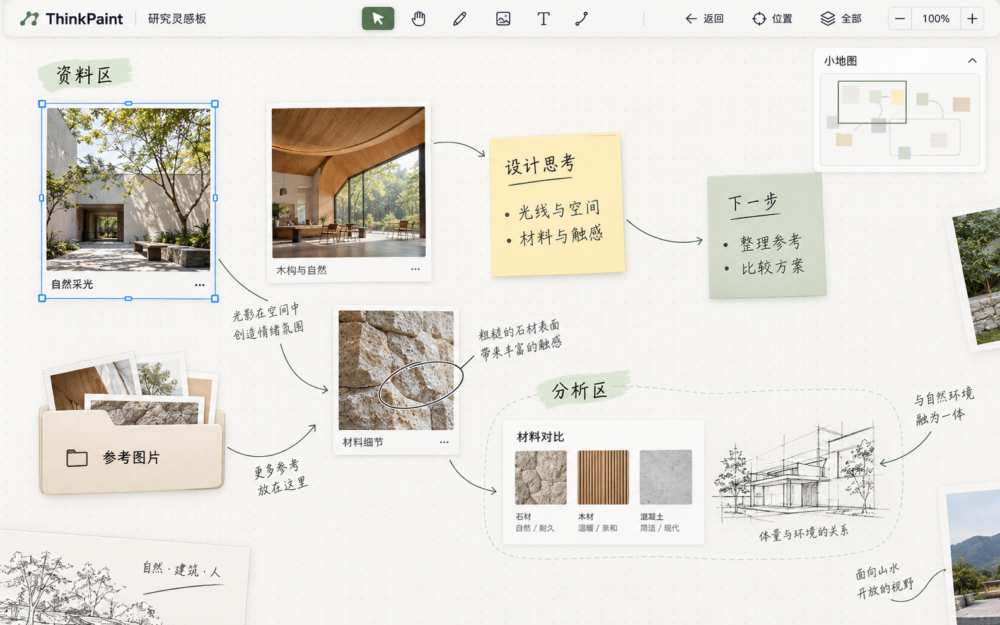

> **2026-10-19 公共架构同步**
>
> 本分支已合入公共基线 `6c95561b2bdaefba3c0eab084b95b34f061b7dfe`。统一路线为 Flutter + Dart + 自定义绘制画布。
> [技术决定](../architecture/PLATFORM_DECISION.md)、[工程结构](../architecture/PROJECT_STRUCTURE.md)、[共享接口](../architecture/SHARED_CONTRACTS.md)、[模块依赖](../architecture/MODULE_DEPENDENCIES.md)、[独立界面设计](../architecture/UI_DESIGN_GUIDE.md)作为当前公共约定。
>
> 本模块计划代码目录为 `packages/thinkpaint_canvas/`，公开入口为 `lib/thinkpaint_canvas.dart`，独立设计资料为 `docs/design/M04/`。当前只同步文档，后续继续精细化界面与功能设计，暂时不写功能代码、不创建工程或安装依赖。
>
> 下方完整保留模块设计、采用决定、验收、接口请求与历史授权。旧的未同步、技术占位、范围限制和版本描述按记录时点阅读；本次同步状态以本段为准，公共接口以当前架构为准。接口提案与待协调问题仍需分别处理，文档同步不代表接口已经实现。模块可更新自身任务卡、设计资料和本模块需求细化；公共协议变更先由管理工作协调。
>
> 保留已批准的 A 布局、原视觉文件、Q1 至 Q7 与 V1 至 V5；架构同步不替代联合接口审阅、实现或设备验收。

# M04 画布模块任务卡

更新日期：2026-10-19（Asia/Singapore）。当前状态：本轮模块方案、接口需求与验收准备完成，按已批准效果图确定视觉基线；右上小地图与顶部工具栏导航已定。原图已保存到 M04 设计目录。Q1 至 Q7 的公共细节、真实工程与设备验收仍待协调，不代表功能实现完成。

## 分配信息

- 模块分支：`module/canvas`，已在本地及 GitHub 建立。
- 模块需求：[画布](../modules/M04-canvas.md)。
- 管理目录：`D:\CodexWorkFolder\ThinkPaint`。
- 分配的独立工作目录：`D:\CodexWorkFolder\ThinkPaint-worktrees\canvas`；本轮已使用 `git worktree add` 创建并核对。
- 初始文档祖先提交：`50bc2e985f67eca6f08a0efec75e6ee196b69e48`。
- 领取时读取模块分支当前 `HEAD` 和对应 `origin/module/canvas`，记录真实准备基线。上面的初始提交仅用于追溯，不要求回退到该版本。
- 准备阶段基线：本地 `HEAD` 与跟踪引用 `origin/module/canvas` 均为 `d5ecdb82b9b06f3e7f977d63e25f0922023ac8a7`；上游为 `origin/module/canvas`，创建后工作区干净。本次发布前另用 `git ls-remote` 实际核对远端仍为该提交，分支无需新建；发布后的最新提交以 Git 记录及远端核验为准。
- 管理目录的架构 0.1 已发布，本次实际核对管理分支 HEAD 为 `6c95561b2bdaefba3c0eab084b95b34f061b7dfe`，管理工作区干净；其进度记录 M01 至 M04 暂缓同步。此前“尚未提交发布”的记录已被此状态替代。
- 统一路线为 Flutter + Dart + 自定义绘制画布。本轮只读参考公共架构，不重选框架。计划代码目录为 `packages/thinkpaint_canvas/`，公开入口为 `lib/thinkpaint_canvas.dart`，工程及可调用协议尚未建立。
- 模块分支尚未包含管理目录的新架构文档，本次以准备阶段基线提交本卡和批准的效果图；未执行公共基线同步或合并。

## 当前授权

允许读取项目文档和 Git 状态，使用本模块独立 Git worktree，整理模块方案、接口需求和验收计划。当前允许修改本任务卡，并将已批准的原效果图保存到 `docs/design/M04/assets/canvas-ideal-v1.png`。

本次对话追加要求：在方案之前先上网调研同类画布，先展示效果设想与结构，项目所有者同意后才确定。该审阅步骤已完成：项目所有者选择 A，并明确“小地图位置放在右上”，“[返回][位置][全部][- 100% +]”整合在工具栏中。本卡按这一决定更新，不把布局同意解释为功能实现或公共协议修改授权。

本次新增授权：以已生成并展示的效果图确定方案，将原图保存至 M04 设计目录，更新本卡中的方案、接口需求与验收计划。文件范围仅为本卡和上述图片；不增加功能代码或其他设计文件。

最新对话授权：将当前 M04 成果提交并推送到对应模块分支；已有分支则跳过创建。本地及远端已存在 `module/canvas`，本次复用并普通推送，范围为本卡和批准的原效果图。此前不提交、不推送的限制已由本次明确授权替代。

本轮不写功能代码，不创建独立应用，不安装开发依赖，不改公共文档、其他模块或共享工程文件。合并、删除分支及应用发布未获授权。取得后续实现授权并有统一技术决策后，再按批准范围进入开发。

## 工作目录准备

先检查 `git worktree list`、本地分支、目录存在情况和已有改动。若已在正确的本模块 worktree，直接使用；若分支已在其他目录检出或路径属于其他工作，不覆盖、不强制重建，报告管理对话。

路径和分支均可用时，创建命令为：

```powershell
git -C "D:\CodexWorkFolder\ThinkPaint" worktree add "D:\CodexWorkFolder\ThinkPaint-worktrees\canvas" module/canvas
```

创建后所有编辑命令使用该目录作为工作目录，核对当前分支、`git rev-parse HEAD`、上游分支及工作区状态，并把实际结果写入本任务卡。

## 阅读顺序

1. 根目录 `AGENTS.md` 与 `PROGRESS.md`。
2. `docs/REQUIREMENTS.md`、`docs/DEVELOPMENT_PLAN.md`。
3. `docs/MODULE_CONTRACTS.md` 与 `docs/TASK_HANDOFF.md`。
4. 本模块 `docs/modules/M04-canvas.md` 及相关协作模块需求。

## 模块准备重点

先梳理四向坐标、平移缩放、可见绘制、类型适配、小地图位置收藏和边缘平移。明确屏幕、画板与局部坐标和各类内容的注册接口；M07 维护对象状态，内容模块维护几何与编辑，M09 维护资源。

## 细项记录

| 细项 | 功能 | 准备状态 | 实际证据 |
| --- | --- | --- | --- |
| M04.01 | 四向扩展与坐标 | 边界与验收准备完成；坐标细节待 Q1 协调 | 本卡“细项顺序”“协作接口”“验收计划” |
| M04.02 | 视图平移缩放与手势 | 已批准效果图与工具栏方案确定；输入规则待 M10 协作 | 官方来源 R1、R2、R3；工具栏需求与 V1/V4 验收 |
| M04.03 | 按视野绘制与资源调度 | 官方调研与验收准备完成；接口待协调 | 官方来源 R4、R5；接口问题 Q2 |
| M04.04 | 内容对象接入与叠放显示 | 混合内容呈现基线确定；真实适配待集成 | 已批准效果图、内容职责及 V1/V3/V5 验收；Q1、Q7 |
| M04.05 | 小地图位置收藏与视图返回 | A 与原效果图已采用；小地图及导航需求记录完成 | 原图与视觉基线；小地图需求、V1/V2/V4 验收；Q3、Q4 |
| M04.06 | 边缘平移与查看条件 | 官方调研与验收准备完成；联合协议待协调 | 官方来源 R7；接口问题 Q5、Q6 |

每次只更新实际完成的准备内容，不把方案完成记成功能实现或实机通过。

## 本轮交付

- 模块内部细项顺序、优先级、可以独立推进的部分与理由。
- 每项所需接口的主责模块、输入输出、事件、失败和取消语义；接口名称先作为提案。
- 跨模块场景的参与方、前置条件、数据变化、撤销与保存要求。
- 验收用例、真实设备与样例需求、性能指标的制定办法；没有实测的数据不填写为结果。
- 技术或产品取舍、阻塞项、需管理对话协调的事项，以及后续可领取的实现范围。
- 实际分支、目录、基线、文件差异和 Git 状态。

## 准备阶段验收

本模块所有细项均有实施安排和验收办法；公共接口职责符合现有协作约定；联合操作的取消、错误和恢复有明确方案；尚无依据的实现路径或技术选择保留为提案。文件差异限于本任务卡和批准的原效果图，图片引用与原图哈希可核对，未产生功能代码。

## 当前事实

由本 M04 开发对话负责；独立工作目录和真实准备基线已核对。已阅读管理目录的进度、需求、计划、模块协作、交接、五份架构文档及 M04 需求与任务卡；已结合 M03/M05/M07/M09/M10 需求完成只读协作审阅。所有功能细项仍未实现。

## 本轮进度

1. 阅读与范围核对：完成。只修改独立 worktree 中的本卡并保存批准的原图，采用管理目录架构 0.1 作为只读参考，保留版本差异。
2. 独立目录与分支核对：完成。当前分支为 `module/canvas`，准备基线如上；发布前实查本地和远端已存在该分支，跳过创建。
3. 官方网页调研与接口审阅：完成。已打开官方页面核实，来源与可借鉴行为如下。未发现需要暂停准备工作的明确文档矛盾，协议缺少的细节列为 Q1 至 Q7。
4. 效果设想、结构与选项展示：完成。项目所有者选择 A，并修订为右上小地图与工具栏内导航；B/C 保留为未采用的比较记录。
5. 同意后的方案细化：完成。项目所有者批准生成的效果图，原图已保存并逐项映射到视觉基线、工具栏/小地图接口需求和 V1 至 V5 验收。Q1 至 Q7 的公共细节、具体数值和设备结果继续保留实际状态。
6. 图片保存与交付检查：原图复制完成，SHA256 一致；文件范围、图片链接、文档与交叉审阅检查结果见“依据版本与本轮证据”。方案及文档检查不代表功能、性能或设备验收通过。
7. 模块成果发布：项目所有者已授权提交和推送至 `module/canvas`。发布检查与命令见下文；实际提交和推送结果以 Git 历史、远端引用和本聊天交付记录核对，不改变功能准备状态。

## 调研记录与来源

访问日期：2026-10-19。以下为官方产品文档或开发文档，均已打开核对。发布年份未标注的资料不推定年份；访问日期不代替发布日期。调研只借鉴行为与职责，不引入参考产品的 SDK、框架、格式或默认参数。

| 编号 | 作者或机构、标题、版本/日期 | 页面中核实的行为 | 对本模块的启发（提案） |
| --- | --- | --- | --- |
| R1 | PureRef，Handbook 2.1，Navigation；页面未标发布日期。[来源](https://www.pureref.com/handbook/navigation/) | 中键或 Alt+左键平移，滚轮缩放；触控板双指平移与捏合；触屏双指平移与捏合；界面主要保留内容 | 导航控件集中且可收起；具体键位需与 M10、文字焦点协调 |
| R2 | Miro，Using Miro with a mouse, trackpad, or touchscreen；页面未标发布日期。[来源](https://help.miro.com/hc/en-us/articles/360017731053-Using-Miro-with-a-mouse-trackpad-or-touchscreen) | 右下角集中缩放、适应全部、小地图和全屏；小地图可显隐；区分鼠标、触控板和触屏 | 借鉴集中组织导航的行为；ThinkPaint 按审阅决定改为右上小地图、工具栏内导航 |
| R3 | tldraw，Camera system；页面标最后编辑 2025-12-20。[来源](https://tldraw.dev/sdk-features/camera) | 视图位置与缩放独立；屏幕与页面坐标转换；聚焦对象和全部；手动导航可中止定位动画 | 分离视图与对象变换；定位允许被新操作中断，保留原视图供返回 |
| R4 | tldraw，Culling；页面标最后编辑 2025-12-20。[来源](https://tldraw.dev/sdk-features/culling) | 屏外对象不呈现但仍在对象状态中；选中和编辑中的对象另行处理；视觉效果越界需考虑完整边界 | 按视野绘制不删对象；边界必须覆盖线宽、文字及装饰，活动预览单独处理 |
| R5 | tldraw，Performance；页面标最后编辑 2026-01-31。[来源](https://tldraw.dev/sdk-features/performance) | 按显示尺寸请求图片分辨率，缩放期间抑制重复切换；几何缓存按变化失效 | 显示缓存可重建，避免每帧反复解码；具体缓存算法和容量仍待验证 |
| R6 | tldraw，Deep links；页面标最后编辑 2025-12-20。[来源](https://tldraw.dev/sdk-features/deep-links) | 分别定位对象、指定视野和整页 | 对象定位与位置收藏应区分；M04.05 已要求收藏视图位置及比例，首轮不扩展“随对象移动的收藏” |
| R7 | tldraw，Edge scrolling；页面标最后编辑 2025-12-20。[来源](https://tldraw.dev/sdk-features/edge-scrolling) | 工具决定拖动时是否启用；手动平移时不重复启用；进入边缘后延迟、逐渐加速，离开停止，可关闭 | 由活动工具请求，M04 只移动视图；延迟、边缘宽度和速度待双端试验 |
| R8 | Obsidian，Canvas；页面未标发布日期。[来源](https://obsidian.md/help/plugins/canvas) | 在二维空间混排笔记、附件与网页并用线连接；移动端有平移、缩放和长按操作 | 检查图片、文字和关系混合时的导航；资料不能证明其支持任意命名视野收藏 |

R4 的 DOM 做法与 R5 的性能示例均属于 tldraw，不能换算成 Flutter 的性能结论。坐标精度、缩放上下限、边缘速度、支持容量和真实设备表现没有通过本轮网页调研得到实测值。

## 已采用的效果与审阅记录

2026-10-19 审阅决定：采用 A；项目所有者将原提案的右下小地图改到右上，并将返回、位置、全部和缩放整合进工具栏。三种布局的比较保留如下，采用状态以本节决定为准。

同日视觉审阅决定：生成图展示后，项目所有者指定按该图确定方案并保存原图。以下图片是本模块已采用的视觉基线；后面的文字线框只用于补充结构，不替代图片。



### 原图记录

- 文件：`docs/design/M04/assets/canvas-ideal-v1.png`，PNG，1586 × 992 像素，2,062,469 字节；尺寸与字节数由本轮实际读取文件得到。
- SHA256：`8f2a1d8e5a9027fdca54397fb882a399272509a74270ace01517f146514ea5d3`。复制前后实际计算一致，保存的是已展示原图，未重绘、裁剪或重新编码。
- 生成方式：上一轮使用内置 imagegen。原文件：`D:\Codex\home\generated_images\01a15226-830e-7af1-9f53-76b41aede30f\exec-837b534b-f8d4-4f7f-8af2-82739658e194.png`。
- 提示词要点：ThinkPaint 中文横向理想界面，暖纸点阵背景、统一顶部工具栏、右上简化小地图、图片/中文便签/手绘/关系线/档案盒混合呈现；完整提示词保留在本聊天上一轮的生成调用中。
- 图片用于视觉设计与后续对照验收；图中内容是展示样例，功能、容量和性能需要实际工程分别验证。

### 已确定的视觉基线

1. 画布使用暖白纸面、低对比细点阵和充足留白；正文深色，导航强调色采用克制的灰绿。背景及点阵归 M04 绘制，具体主题角色、色值、字体和间距由 M10 统一提供。
2. 顶部为一条统一工具栏：左侧应用标识和画板名称，中部主工具，导航组按“返回、位置、全部、减小比例、当前比例、增大比例”排列。M04 的导航动作加入同一工具栏；应用标识、主工具及完整外壳由 M10 装配。
3. 小地图放在工具栏下方的画布右上角，以浅色面板、简化色块/连线和清晰的视野框呈现；支持收起。它只表现真实场景和当前视图，不能使用固定示意色块替代实际内容。
4. 主体按图中疏密关系呈现图片卡片、淡黄与浅绿中文便签、手绘标注、细连接线、档案盒和主题区域，画布边缘可见部分内容以表现持续延伸。对象由用户自由放置，示意排布不成为自动布局或固定分区规则。
5. 图中的图片边框与档案盒由 M03 提供，文字与便签由 M06 提供，笔迹与线条外形由 M02 提供，关系绑定由 M08 提供，蓝色选框/控制柄和区域身份由 M07 提供；M04 调用适配呈现。照片、文字示例、手写字形、装饰及标识不新增内容类型或修改对象归属。
6. 实现验收以相对布局、层次、留白、背景和混合内容的一致性为依据；设备字体、像素密度及响应式尺寸按 M10 约定适配。窄屏和其他背景选项继续按既有需求处理。

- A（已采用并修订）：画布占据主体，可收起的小地图放在画布可用区域右上角；返回、位置、全部、缩放整合进 M10 工具栏。位置收藏从工具栏入口按需展开。小地图需要避让工具栏、其他面板和系统安全区。
- B（未采用）：常驻导航侧栏，上部小地图，下部位置收藏。频繁在远处区域往返更直接，代价是压缩画布，平板竖屏和窄窗口需要折叠。
- C（未采用）：仅保留紧凑导航入口，点击后临时展开总览与收藏。画布空间最大，代价是查看全局和切换位置多一步。

已采用布局的补充文字线框如下。主工具栏和公共主题属于 M10，M04 贡献导航动作与状态；颜色角色与组件尺寸在已批准效果基础上由 M10 统一定义。图像与线框均为设计资料，未生成可运行界面。

```text
┌─────────────────────────────────────────────────────┐
│ M10 工具栏：主工具 │ 返回 │ 位置 │ 全部 │ - 100% +    │
├─────────────────────────────────────────────────────┤
│                                   ┌───────────────┐ │
│                                   │ 小地图：轮廓  │ │
│                                   │ 当前视野矩形  │ │
│                                   └───────────────┘ │
│                                                     │
│     图片、文字、手绘、档案盒及关系线混合的画布         │
│     可向左、右、上、下继续平移添加内容                 │
│                                                     │
└─────────────────────────────────────────────────────┘
```

已采用的交互方向与后续细节：

1. 画布内容四向延伸；平移只改变查看位置。缩放围绕鼠标所在点或双指中心，正常缩放、聚焦选择和查看全部均有可见入口。
2. 右上小地图呈现简化轮廓与当前视野矩形，避免再加载全板原图。点击区域定位，拖动视野框平移；空板、只有一个对象、极远离群对象及当前视野在内容外时，比例和提示规则继续细化。
3. 工具栏中的“位置”展开命名收藏，例如“资料区”“分析区”；收藏中心与比例。跳转后通过工具栏“返回”回到跳转前视图；编辑撤销仍只处理对象编辑。
4. 只在活动拖动工具请求时触发边缘平移；边缘给出轻量方向反馈，短暂停留后逐渐移动。停止、取消或失焦须结束移动。取消编辑是否恢复原视图尚未决定。
5. 筛选、关系专注或临时显示启用时给出可辨认提示与退出入口；原对象身份、布局和绑定由 M07 保持。具体提示承载与 M05、M08、M10 协调。
6. 加载显示资源、资源失败、空画布、目标已删除和视图保存失败分别表达；有错误时不显示为加载或保存成功。

### 工具栏和小地图的协作要求

- M04 通过既有 UI 贡献方式提供“返回、位置、全部、缩放”的动作、可用状态、实际比例和提示；M10 负责工具栏承载、主题、布局与焦点。具体共享注册字段由管理工作协调，当前不创建新公共协议。
- 顺序为“返回、位置、全部、缩放”；“返回”在无导航历史时不可用；“位置”承载收藏列表和命名入口；“全部”按约定的有效内容范围定位，空板明确显示暂无内容；缩放区显示实际比例并提供减小、恢复正常缩放和增大操作。筛选与专注下的有效范围仍由 Q5 明确。
- 右上小地图相对可用画布固定，平移画布时位置不随对象移动；小地图点击和拖动只用于导航，不穿透到下方对象或重复触发边缘平移。
- 窄窗口、分屏、转屏及输入法出现时，导航仍由同一工具栏承载；具体压缩或工具栏溢出方式由 M10 协作确定，保留全部导航能力和键盘/触摸入口。
- 工具栏与收藏面板遵守 M10/M06 的文字焦点规则；点击导航时按当前工具约定处理未结束输入，不直接抢走组合输入。小地图、工具栏和其他面板遮挡后的有效画布范围需要传给 M04，用于聚焦边距与边缘平移。

### 视觉基线对应的接口需求

下列字段与行为是对现有端口和 UI 贡献的需求说明，尚未修改公共签名；主责及关联问题沿用 Q1 至 Q7。

| 对象与协作方 | 需要传入的资料 | 动作、结果与一致性要求 | 对应问题 |
| --- | --- | --- | --- |
| 工具栏导航：M04 贡献、M10 承载 | 当前 boardId/sessionId/viewRevision、实际缩放、是否可返回、是否有可定位内容、收藏列表与保存状态；M10 提供工具栏槽位及焦点上下文 | 用户动作进入当前会话的返回、收藏菜单/定位、查看全部和缩放入口；定位按视图请求顺序处理，空板/无历史明确禁用或提示；导航不生成对象编辑事务 | Q3、Q4、Q5；M10 UI 贡献 |
| 右上小地图：M04 调度、内容模块提供简化几何 | M07 正式快照、父子变换/层次/可见状态、内容视觉边界或简化轮廓、M05/M08 查看条件及 M04 当前视野；这些资料对应明确版本 | 输出区域定位或视野移动请求，变化映射到同一 ViewportPort；折叠与异步准备不得把旧画板轮廓显示为当前内容，不为小地图加载全板原图；范围规则待 Q5 明确 | Q1、Q3、Q5、Q7 |
| 有效画布范围：M10 外壳与 M04 覆盖层 | 工具栏、系统安全区、键盘、打开面板和小地图的实际占用区域，以及窗口逻辑尺寸和像素密度 | 向 M04 提供可用边界及遮挡资料，不能只用整窗大小；聚焦和缩放锚点避让控件，边缘拖动进入控件时停止误触发；非矩形遮挡的表达由双方协调 | Q1、Q6、Q7 |
| 点阵、卡片和选框：M10/内容模块/M07 与 M04 | 主题与背景设置、内容已准备的呈现资料、完整视觉边界、活动选区与编辑预览；选择/预览归所属模块 | 点阵随同一视图变换稳定移动；显示边界覆盖卡片阴影、线宽与文字，预览在约定层次绘制；选框不进入正式正文或默认导出，具体输出范围由 Q7 明确 | Q1、Q2、Q7 |
| 资源与位置恢复：M09 与 M04 | 图片 AssetRef、所需显示尺寸与取消上下文、保存的 ViewSnapshot 和 SavedCheckpoint | 按视野准备图片，引用不变而显示缓存可重建；收藏与最后位置按 viewRevision 保存恢复；取消/缺图/保存失败真实表达，加载和保存结果不得跨会话覆盖 | Q2、Q3、Q4 |

正式对象、持久隐藏、收藏保存、字体布局和原图仍使用原有主责。效果图确定了外观方向，未将内容编辑、文件持久化或主工具会话移入 M04。

## 模块结构与职责

下列结构表达职责和数据流，不决定内部目录、第三方库、空间索引、缓存算法或新框架。

```text
M10 标准输入、焦点与唯一工具会话
                  ↓
M04 坐标与视图 ─────────→ 导航、小地图、位置收藏
                  ↓
M04 可见范围、绘制顺序与资源准备调度
   ↑ M07 正式快照、归属、层次、隐藏；M05/M08 查看条件
   ↑ 各内容类型的几何、命中与呈现适配
   ↑ M09 原图/资源读取 → M04 可重建的显示缓存
                  ↓
同步屏幕绘制 / 固定正文快照的区域及离屏绘制 → M09 导出
```

屏幕位置、画板位置和对象局部位置必须区分。父子变换来源为 M07；内容边界与命中算法由相应内容模块提供。原画板坐标保留，绘制使用相对当前视图的坐标，这一原则已写入架构 0.1；坐标轴方向、组合顺序、精度范围及容差待 Q1 明确。

## 细项顺序与可独立准备的部分

本轮按以下依赖顺序安排后续细化与实施准备；原编号和验收保持，功能实现仍需另行授权。

1. M04.01 四向坐标：先明确单位、屏幕视口、局部与父级变换、远坐标和非法输入。后续绘制、命中与拖动都依赖它。
2. M04.04 类型接入：核对类型注册、完整视觉边界、几何命中、同步呈现和预览入口，先保证真实内容可以接入。
3. M04.02 平移缩放：在同一坐标约定下明确键鼠、触控板、触摸、笔与取消；与 M10 的输入分工共同验收。
4. M04.03 视野与资源：基于已接入类型安排可见范围、邻近准备、显示分辨率、缓存失效及释放，分别检查大图和大量对象。
5. M04.05 导航：组合查看全部、聚焦、小地图、收藏与返回，再与 M01/M05/M09 对接切换、搜索和保存。
6. M04.06 联合拖动与查看条件：在导航及当前工具可用后验证边缘平移，再验证筛选、专注与临时显示的组合及导出范围。

官方资料核实、现有职责核对、布局审阅、工具栏状态和验收矩阵准备已完成。坐标样例、类型输入输出及具体数值继续按 Q1 至 Q7 与主责协作细化；真实内容、资源及设备尚未接入的部分保留待集成。功能实现还需要工程、最小协议与对应实现授权。

## 协作接口与失败语义

现有端口名称来自管理目录共享接口 0.1，均为文档设计，没有可调用实现。本卡只提出需要补齐的资料与行为，不修改公共协议。

| 协作方与现有端口 | 输入与输出需求 | 事件、失败、取消及归属 |
| --- | --- | --- |
| M04 提供 ViewportPort；M01/M02/M03/M05/M06/M07/M08 消费 | 逻辑像素点、会话及对应视图、对象标识与变换上下文 → 画板/局部坐标；当前视图；准备、定位与临时显示结果 | changes 关联 SessionId/viewRevision；旧请求不能覆盖新定位；失效会话、目标消失、非法坐标和不可逆变换需要明确结果；取消中止本次定位 |
| M07 提供 DocumentReadPort、EditorPort、BoardSessionPort | 不可变正式快照及完整变更 → 层次、归属、锁定隐藏与刷新依据；拖动工具提交完整 EditPlan | M04 不持有第二份可编辑正文，不写正式变换；M07 返回版本冲突，操作主责重新规划并展示预览；导航不进入编辑撤销 |
| M02/M03/M06/M07/M08 提供内容类型与 GeometryProvider、ObjectPainter | 对象、上下文与资源需求 → 边界、局部命中、已准备的呈现资料及同步 paint | 类型自身维护专用编辑、编解码与搜索资料；未知类型、准备失败与资源缺失明确报告；paint 不读文件、不解码、不等待异步 |
| M09 提供 AssetStorePort，M04 维护显示缓存 | AssetRef、所需显示尺寸/版本及取消上下文（细节待协调） → 可用资源或明确失败 | 原图与持久引用归 M09，显示句柄及缓存归 M04；旧会话、旧内容或已离开视野的异步结果不覆盖新呈现，释放规则见 Q2 |
| M04 提供 SceneRenderPort，M09 导出器消费 | 固定 DocumentSnapshot、区域、像素尺寸、背景与显式查看范围 → RenderedPage | 不隐式读取活动视图；所需资源准备完整才成功；缺图、未知类型、超限或取消分别报告，文件写入和 PDF 组合归 M09 |
| M09 提供 SaveCoordinatorPort；M01 编排切换 | SceneSnapshot 与 ViewSnapshot → SavedCheckpoint，分别覆盖正文和视图版本 | 仅视图/收藏变化也需安排保存；正文成功不能掩盖视图失败；准备失败保留源会话，迟到恢复不覆盖搜索定位 |
| M10 提供 PlatformInputPort、ToolRuntimePort、SettingsPort 与外壳 | 指针身份、时序、逻辑像素、焦点、能力、有效视口与操作偏好 → 导航动作或当前工具处理 | 输入法优先；笔与手指按工具设置分工；取消、失焦、后台、设备断开和切换工具终止边缘移动；主题与顶层路由由 M10 协调 |
| M05/M08 提供查看条件；M03 提供 ImagesPort | 筛选集合、关系专注、临时显示请求、最新容器归属 → 当前可见集合及 RevealLease；盒内结果先展开再定位 | M05 编排搜索，M03 负责展开；M04 不直接改隐藏或盒成员；lease 取消/释放不覆盖期间的新条件，组合规则待 Q5 |

## 请求管理工作协调的接口问题

以下为本卡记录的协调请求，尚未向其他聊天或外部服务发送消息。签名及产品行为获审阅、主责协调后再进入公共文档。

| 编号 | 需要明确的问题 | 主责与受影响方 | 阻塞范围 |
| --- | --- | --- | --- |
| Q1 | 坐标轴、单位、有效视口原点、父子变换组合、非有限值/不可逆变换、容差单位、视觉/命中/裁剪边界及版本。GeometryProvider 属纯 Dart，需能独立于 Flutter UI 注册取得无状态几何 | M04 主责，M07/M02/M03/M06/M08/M10 参与 | 真实坐标、命中、几何规则和导出一致性 |
| Q2 | AssetStorePort.read 尚未细化显示尺寸、变体、准备通知、所有权、释放、取消、内存压力和迟到结果。明确 M03/M04/M09 各自提供什么，不重复维护原图或同类缓存 | M09 资源协议、M04 显示调度，M03 参与 | 大图调度、缓存资源验收 |
| Q3 | prepareView 的准备句柄、目标会话绑定、同步激活/释放及请求顺序；新手动导航是否打断程序定位；禁止旧恢复影响新定位 | M04/M01/M07，M05/M09 参与 | 切板和搜索定位联合验收 |
| Q4 | ViewSnapshot 已含位置收藏；补齐收藏标识、命名改名、跨端版本、仅视图变化保存触发、导航历史生成与保留范围、保存失败反馈 | M04 视图语义、M09 持久化，M01/M10 参与 | 收藏及最后视图恢复；不扩展为对象锚定收藏 |
| Q5 | 持久隐藏、盒折叠、筛选、专注和多个 RevealLease 的组合；乱序释放和中途改变条件；小地图、查看全部、聚焦与导出的查看范围 | M04 协调查看语义，M05/M08/M03/M07/M09 参与 | 完整内容与当前查看条件的联合行为 |
| Q6 | 活动工具请求边缘平移的开始/更新/停止，指针和会话标识、有效视口、视图更新后工具重算、失焦取消；取消编辑是否恢复原视图待产品审阅 | M04/M10/M07，M02/M03/M08 按工具参与 | 拖动稳定性、一次提交和完整取消 |
| Q7 | 预览和控制柄的注册、层次、裁剪及释放；小地图、缩略图和导出是否包含临时预览；固定 RenderRequest 的查看条件与失败/取消表达 | M04 呈现，M07/M02/M03/M06/M08/M09/M10 参与 | 混合绘制、离屏呈现及编辑中导出 |

布局审阅后的 M10 协作补充：在既有 UI 贡献中承载工具栏导航，传递动作状态、实际缩放和有效画布范围；右上小地图避让工具栏、安全区与面板。此项只在本卡登记，未改 M10 任务卡或公共外壳约定；对应 Q6、Q7 的输入与覆盖层细节共同审阅。

## 验收计划

下列为验收准备，不含运行结果。原需求中的验收保持，具体阈值、设备及样例在首次功能测试前确定并记录。本轮未生成测试代码、性能实验或模拟结果。

| 细项 | 固定样例与操作 | 核对内容及保留证据 |
| --- | --- | --- |
| M04.01 | 同一混合内容放在原点、四个象限和远处；叠加分组、图片附着批注、旋转/翻转及多级变换；反复换算和平移缩放 | 记录实际坐标范围、最大屏幕误差与循环漂移，比较屏幕、命中、预览和导出；非法值和不可逆变换有明确失败 |
| M04.02 | 鼠标、触控板、Android 单指/双指与主动笔分别操作；缩放中取消、失焦、转屏、窗口及键盘区域变化；中文组合输入期间导航快捷键 | 缩放锚点稳定、对象坐标不因导航改变，同一输入只归一个有效工具；逐设备保留步骤、视频、事件顺序和结果 |
| M04.03 | 分别固定单张大图、多图、大量笔迹、大量普通对象和混合场景；快速往返已访问与未访问区域；加载时删除/裁剪对象、切换会话及释放场景 | 记录帧耗时分布、内容出现延迟、峰值及稳定后内存、资源请求/解码/句柄数量；确认取消和迟到结果不串会话，重复往返不持续泄漏 |
| M04.04 | 实际注册图片、文字、笔迹、自由箭头、关系线、分组/区域、档案盒；覆盖遮挡、隐藏、锁定、裁剪、折叠、粗线、标签及回环 | 新类型通过适配接入；显示/命中顺序一致，屏外本体仍可能有可见笔画或装饰；与 M09 区域导出比较几何位置和所选范围 |
| M04.05 | 空板、单对象、相距很远的主题区及离群对象；小地图跳转、收藏命名和重开、返回；Windows→Android→Windows；连续定位 A/B、旧恢复迟到和同板新会话 | 收藏及最后视图来自实际保存版本；导航不增加编辑撤销；盒内目标由 M05/M03 展开定位；旧回调不能覆盖新视图，保存失败真实展示 |
| M04.06 | 活动拖动在四边和四角停留，移回中央、释放、取消、越出窗口、失焦、工具切换及设备断开；交叉隐藏/锁定/折叠/筛选/专注/多个临时显示 | 无指针新移动时也能更新拖动位置；编辑工具仍仅产生一个完整事务，取消不留正式变换；释放 lease 不恢复旧条件；导出范围选择可核对 |

已选布局的补充验收：在 Windows 宽/窄窗口、Android 横/竖屏、分屏和输入法展开状态，核对小地图位于有效画布右上、导航动作均在工具栏中可访问、实际缩放显示同步。小地图点击/拖动、工具栏按钮及收藏输入不误选底层对象、不重复触发边缘移动；无返回历史与空板状态可辨认；面板遮挡后的聚焦和边缘移动使用正确的可用范围。此项尚未实机执行。

### 已批准效果图的对照验收

参考文件固定为 `canvas-ideal-v1.png`，使用当前记录的哈希。后续建立包含相同内容类别、相近位置关系的真实固定画板，并记录其版本、字体与资源；不能以整张效果图作为背景截图冒充实现。以下均为待执行计划。

| 编号 | 关联细项与参与方 | 验收操作与判断依据 | 证据及当前状态 |
| --- | --- | --- | --- |
| V1 | M04.02/.04/.05；M10 与内容模块 | 宽屏按参考图的比例建立场景，核对暖白点阵、顶部单一工具栏、右上小地图、内容留白与层次；导航组顺序及当前比例来自实际状态，主画布可平移 | 固定场景版本、窗口逻辑尺寸/像素密度、实机截图与人工对照记录；待工程与适配 |
| V2 | M04.02/.05/.06；M10/M06 | 缩窄窗口、转屏、分屏、展开键盘与面板，再操作收藏和缩放；导航动作始终由同一工具栏承载，小地图保持可用画布右上并避让必要操作区 | 各布局截图、焦点及指针事件记录；待真实双端设备 |
| V3 | M04.01/.03/.04；M02/M03/M06/M07/M08 | 平移缩放真实图片、中文便签、粗细笔迹、关系线、盒和区域；选框、阴影与文字不被错误裁剪；从原点移至远处后显示、命中与编辑预览一致 | 真实对象快照、视觉/命中对照、坐标误差；容量与时延另按预先确定指标测试；待集成 |
| V4 | M04.05/.06；M05/M07/M09/M10 | 改变内容、视图与查看条件，核对小地图轮廓和视野框随动；点击/拖动不穿透，导航可返回，收藏重开恢复；连续请求和换会话后旧结果不覆盖新状态 | 导航/版本/保存结果、资源请求及操作录像；待相关接口 |
| V5 | M04.04/.06；M09 与各内容模块 | 固定同一正文快照，按显式背景、装饰和查看范围生成区域导出，对照对象位置、线条和中文；应用工具栏、小地图和编辑控制柄不被误导出 | 屏幕与实际导出文件、固定请求和资源完整性结果；待离屏呈现与 Q7 协调 |

视觉审阅已通过；上述截图对照、功能交互、资源完整性、跨端与性能验收均未执行。图中未展开的收藏菜单、错误和取消状态继续使用本卡已有要求，不能仅凭静态效果判断通过。

联合验收准备：

1. M07/M08/M03：拖动带批注图片或容器穿越边缘，变换与连接在同一事务；取消无部分变更，一次撤销恢复内容与关系。M04 只更新视图和预览。
2. M01/M07/M09/M10：切板期间源视图继续移动、保存失败或目标资源失败；有效保存回执与当前版本不符时不能凭旧回执离开，失败保留源会话。
3. M05/M03/M07/M08：搜索定位盒内、隐藏或被筛选目标；重新解析身份和归属，再展开、临时显示与聚焦；取消或目标消失有明确结果。
4. M09 与全部内容模块：固定正文快照比较屏幕和区域/离屏导出；输出范围明确选择当前查看条件或完整内容；缺图、字体/类型失败按所属模块规则报告，不把遗漏输出报告成功。
5. M06/M10：文字组合输入与导航、触摸、笔操作共存；焦点优先级和系统取消真实生效。

设备与负载的制定办法：

- 记录 Windows 电脑、显示缩放、鼠标、触控板、数位板/笔屏，Android 平板、系统、主动笔及驱动/能力；目前未分配验收设备。
- 使用真实可授权资源；为固定画板记录对象类型/数量、图片数量与像素/字节、笔迹点数、坐标分布、嵌套深度、字体、随机种子（适用时）、资源哈希和代码/工具链版本。
- 首先建立可复现的正确性基线和固定导航路径，再比较改动；候选优化每次只改一个变量，在同一设备、同一负载与同一路径重复测量，先估计重复运行噪声。
- 在运行前规定帧耗时分位数、输入延迟、资源出现时间、内存预算、坐标误差、停止响应及保存恢复目标；目前均未设定数值。参考产品的对象数量或参数不能作为本项目指标。
- 后续性能验证按管理方统一格式记录；尚无格式时再按授权建立实验记录。本次只更新任务卡并保存批准的原图，没有运行实验。

## 阻塞项与下一步

- 布局与视觉审阅已完成：A 与已保存原效果图正式采用，右上小地图、顶部工具栏导航和暖纸点阵方向已确定；视觉选择阻塞已解除。主题角色映射、组件尺寸、交互参数和公共接口实现仍待主责细化。
- 公共基线：管理目录架构 0.1 已发布，读取时管理 HEAD 为 `6c95561b2bdaefba3c0eab084b95b34f061b7dfe`；本模块准备基线为 `d5ecdb82b9b06f3e7f977d63e25f0922023ac8a7`，本次只发布自身设计，公共架构未同步的状态继续保留。后续同步由管理工作安排。
- 共享接口：Q1 至 Q7 尚无公共签名/实现与联合审阅结果。可继续准备文档，实际集成依赖相应协议。
- 工程与真实内容：Flutter 应用、协议包及本模块包尚未建立；各类真实适配未在本 worktree 接入。
- 实机与性能：设备、统一负载和验收阈值未指定；坐标精度、内存、帧耗时、笔触摸共存与跨端恢复均未实测。

本轮交付为已保存原图、确定的视觉方案、接口需求及验收计划。下一步由管理工作协调 Q1 至 Q7、公共基线与 M10 工具栏承载；本模块按已批准效果继续细化坐标样例、接口字段、联合取消与错误流程。公共主题、路由、工具栏布局和真实工程由相应主责处理；功能开发另需明确授权。

## 依据版本与本轮证据

Git 核对命令及实际结果：

```text
git worktree add D:\CodexWorkFolder\ThinkPaint-worktrees\canvas module/canvas
Preparing worktree (checking out 'module/canvas')
HEAD is now at d5ecdb8 docs: add ten module handoffs and published branch setup

在 canvas worktree 中：
git branch --show-current → module/canvas
git rev-parse HEAD → d5ecdb82b9b06f3e7f977d63e25f0922023ac8a7
git rev-parse --abbrev-ref --symbolic-full-name @{u} → origin/module/canvas
git rev-parse origin/module/canvas → d5ecdb82b9b06f3e7f977d63e25f0922023ac8a7
git status --short（创建后、编辑前）→ 空
```

下列 SHA256 保留首次调研从管理目录 `D:\CodexWorkFolder\ThinkPaint` 实际读取的文件快照。首次读取时公共架构尚未发布；当前发布状态已更新在分配信息中。它们用于区分历史已读版本，不能代替本次核对记录。

```text
06499a89dbb3e1f777fd3fbae309b7b495013796b8a7b1c1a363db6b768652de  docs/architecture/PLATFORM_DECISION.md
d9bea090760af38ed665c163fc12715444e2f718c2f71650edcdc0d752579bdc  docs/architecture/PROJECT_STRUCTURE.md
b3dc37bdc4e48e9e9d2a8ec56c31284bfd27f18d454a0fc72f0f875e0758e8ec  docs/architecture/SHARED_CONTRACTS.md
d233350a26e06a86960faedc2b39bea57ccedb8fb1daa92f9483463947828575  docs/architecture/MODULE_DEPENDENCIES.md
213460ba66261eef59febffcd3826a3d1e0759bbf21162969596c9e7520adf51  docs/architecture/UI_DESIGN_GUIDE.md
02413da51c4f31bdbb0a4f1bce94149e3769fcf0e8ba522872b54270ca524b86  docs/modules/M04-canvas.md
aa80a74002f47550e99d23d38f3bc783bc8510403687998f3e2b4927b33a16db  docs/tasks/M04.md
```

前轮文档验证：已逐项重读全部差异并做只读交叉审阅；`git diff --check` 退出码为 0。脚本检查 UTF-8 有效、无替换字符、六个原细项齐全、代码围栏成对、本地相对链接存在，均通过。当时 `git status --short` 仅有 ` M docs/tasks/M04.md`，`git diff --cached --name-only` 为空。该结果是图片加入前的历史记录；本次范围包含原图。

准备阶段的对外与功能验证状态：该阶段没有运行 Dart/Flutter 构建、功能或硬件测试，没有提交、推送或合并。当前已新增模块成果提交和推送授权；官方资料核实、文档检查与视觉审阅不代表功能或性能通过。

2026-10-19 前轮布局审阅更新：项目所有者选择 A，指定右上小地图及工具栏内导航；该轮仅更新本卡的采用状态、文字线框、工具栏协作要求和相关验收。

### 本次图片保存与方案确定记录

本次管理目录核对：HEAD 为 `6c95561b2bdaefba3c0eab084b95b34f061b7dfe`，工作区干净；五份架构文件中，技术路线、工程结构、共享接口、UI 设计约定与首次记录哈希一致，模块依赖当前 SHA256 为 `98551fc94b230e05a2e5596663abf26f7d2d19b1414e79131fe0df771962fb1b`。已重读该依赖文档，M04 主责与接口边界一致。本次只读参考，未同步或修改管理目录。

图片保存操作在 `module/canvas` worktree 中执行：

```powershell
New-Item -ItemType Directory -Path docs/design/M04/assets -Force
Copy-Item -LiteralPath 'D:\Codex\home\generated_images\01a15226-830e-7af1-9f53-76b41aede30f\exec-837b534b-f8d4-4f7f-8af2-82739658e194.png' -Destination docs/design/M04/assets/canvas-ideal-v1.png
Get-FileHash -LiteralPath docs/design/M04/assets/canvas-ideal-v1.png -Algorithm SHA256
```

实际执行前已确认目标不存在；复制后字节数为 2,062,469，SHA256 为 `8f2a1d8e5a9027fdca54397fb882a399272509a74270ace01517f146514ea5d3`，与原图相同，原文件继续保留。已查看原图并核对右上小地图、工具栏内导航与混合内容效果。

本次检查结果：`git diff --check` 退出码为 0；脚本检查 UTF-8、围栏成对、六个原细项、Q1 至 Q7、V1 至 V5、两个本地链接、PNG 签名/尺寸/字节数、源图与保存图 SHA256 一致，均通过。只读交叉审阅未发现职责、采用状态或验收记录问题。

`git status --short --untracked-files=all` 实际仅有下列两项，暂存区为空，模块 HEAD 仍为 `d5ecdb82b9b06f3e7f977d63e25f0922023ac8a7`：

```text
 M docs/tasks/M04.md
?? docs/design/M04/assets/canvas-ideal-v1.png
```

上述图片保存阶段没有生成新图片、写功能代码、运行 Dart/Flutter 或实机测试，也没有提交、推送或合并。模块成果提交与推送属于下述新增授权阶段。

### 模块成果提交与推送

2026-10-19，项目所有者明确要求建立对应 M04 分支并推送当前工作；已有分支则直接推送。实际检查当前 worktree 为 `module/canvas`，本地分支与远端 `refs/heads/module/canvas` 均已存在，故跳过创建分支。

发布前远端核验：

```text
git ls-remote --heads origin refs/heads/module/canvas
d5ecdb82b9b06f3e7f977d63e25f0922023ac8a7  refs/heads/module/canvas
```

纳入提交的文件只有本卡和 `docs/design/M04/assets/canvas-ideal-v1.png`。批准的视觉方案、接口需求、验收计划、未解决的 Q1 至 Q7 与原图哈希均保留，不新增功能实现。提交前检查图片完整性、本地图片引用、暂存范围及 `git diff --cached --check`；使用普通提交和普通推送，不强制更新远端。

```powershell
git add -- docs/tasks/M04.md docs/design/M04/assets/canvas-ideal-v1.png
git diff --cached --check
git commit -m "docs(M04): finalize canvas design and approved visual"
git push origin module/canvas
git ls-remote --heads origin refs/heads/module/canvas
git status --short
```

发布后的提交号与远端引用以实际 Git 输出及本聊天的完成记录为准；本卡不填写自身提交号，避免提交内容和哈希相互依赖。本次授权覆盖当前 M04 分支成果，不包括合并主分支、同步公共架构或发布应用。
